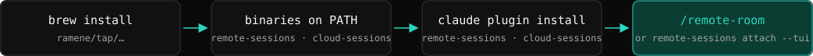
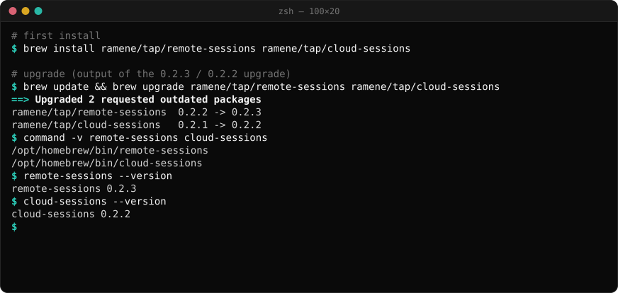
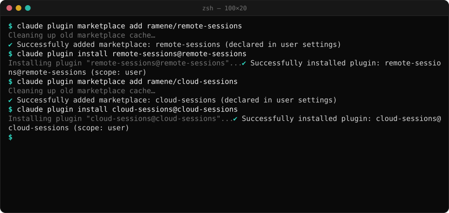
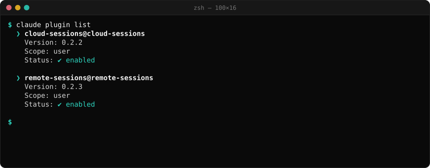
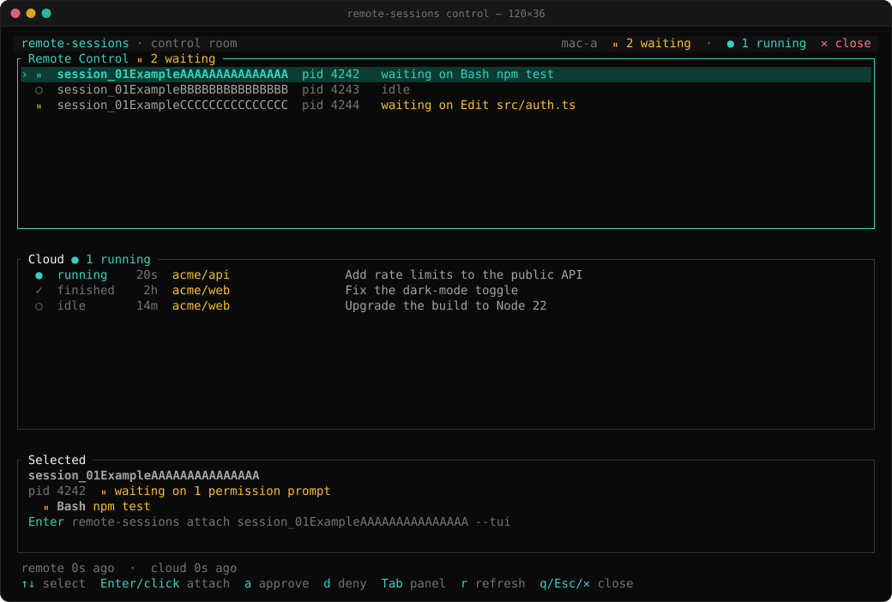

# Getting started with cloud-sessions

This guide shows the steps from install to your first cloud session. Pictures e, f and g are real terminal output from an install, with only machine-specific lines removed. The flow picture is a drawing. For all commands and options, see the [README](../README.md).



*The install flow (drawing). The last step opens the control room of [remote-sessions](https://github.com/ramene/remote-sessions).*

## 1. Install the program

```bash
brew install ramene/tap/cloud-sessions
```

To upgrade later: `brew update && brew upgrade ramene/tap/cloud-sessions`. Check with `cloud-sessions --version`.



*Homebrew upgrade of the two tools, cloud-sessions and remote-sessions (real output).*

The program is needed for `start`, `list`, `collect`, `cast`, `routines`, `stop` and the MCP server. Without Homebrew, the plugin's launcher can download the release for the plugin's version and checks its SHA-256 first. To build it yourself, see [Install](../README.md#install).

## 2. Install the Claude Code plugin

```bash
claude plugin marketplace add ramene/cloud-sessions
claude plugin install cloud-sessions@cloud-sessions
```

In a Claude Code session that is already open, type `/reload-plugins` to load the plugin.



*Add the marketplace, then install the plugin at user scope (real output; it also shows remote-sessions).*

Check that the plugin is enabled:

```bash
claude plugin list
```



*`claude plugin list`: Scope: user, Status: ✔ enabled (real output).*

## 3. Log in

- **Start and send** use the login of the `claude` CLI. Sign in to Claude Code once. cloud-sessions never sees that login.
- **`/cloud-read` and `/cloud-watch`** inside Claude Code use Claude Code's built-in `RemoteTrigger` tool. They need nothing extra.
- **The standalone program** (`events`, `watch`, `cast`, `collect`, the account view of `list`, `routines`) needs a token that can read sessions. A token from `claude setup-token` cannot (HTTP 401). Opt in once, at a terminal, to let the program use Claude Code's own login:

```bash
cloud-sessions auth use-claude-login     # type yes; it refuses to run without a terminal
cloud-sessions auth status               # values are never shown
```

Where the login comes from:

- On macOS: the login keychain first. When the keychain has no login, the login file.
- On Linux: the login file only.
- The login file is `$CLAUDE_CONFIG_DIR/.credentials.json` when `CLAUDE_CONFIG_DIR` is set, else `~/.claude/.credentials.json` (0.2.2 and later).

Other forms: a token that can read, kept in a private 0600 file (`printf '%s' "$TOKEN" | cloud-sessions auth set --file`), or the keychain (macOS and Windows). Undo the opt-in with `cloud-sessions auth revoke-claude-login`. Over `ssh` a macOS login keychain is locked; use the login file or the token file there. See [Authentication](../README.md#authentication).

## 4. First steps

Run `cloud-sessions list` (or `/cloud-list`) first. It says what to do next:

- Login not allowed yet: it shows the sessions tracked on this computer (none on a new computer) and the hint `cloud-sessions auth use-claude-login (asks for a typed yes)`. Run that in a terminal; then `list` shows the sessions and routines of your account.
- No sessions yet: it says how to start one (`/cloud-start`, or `claude --cloud` in a repository checkout) or track one (`/cloud-track <link>`).
- The account list failed: it shows the tracked sessions and one line with the reason and the fix.


Before the first start, allow the repository once and run `claude` once in that folder to accept its trust prompt:

```bash
cloud-sessions allow --dir ~/code/my-repo      # or type /cloud-allow in Claude Code
```

| Step | In Claude Code | In a terminal |
| --- | --- | --- |
| Start a session for the current repository (costs cloud usage, 5 a day by default) | `/cloud-start <prompt>` | `cloud-sessions start --dir ~/code/my-repo --prompt "…"` |
| List your account's sessions and routines (after `auth use-claude-login`), else the tracked ones | `/cloud-list` | `cloud-sessions list` |
| List only the sessions this computer started or tracks | `/cloud-list --tracked` | `cloud-sessions list --tracked` |
| Track a session started elsewhere (the app, another computer, a routine) | `/cloud-track <link or ID>` | `cloud-sessions track <link or ID> --title "…"` |
| Read the events of a session | `/cloud-read <link or ID>` | `cloud-sessions events <session>` |
| Follow a session until it finishes | `/cloud-watch <link or ID> [seconds]` | `cloud-sessions watch <session>` |
| Send a follow-up message | `/cloud-send <link or ID> <message>` | `cloud-sessions send <session> --message "…"` |
| Write each tracked session's latest result into a markdown file | `/cloud-journal [path]` (default: `$CLOUD_SESSIONS_JOURNAL`) | — |

`/cloud-start`, `/cloud-send` and `/cloud-allow` run only when you type them; the model cannot call them. A sent message steers a session; it cannot approve a permission prompt. Event text is untrusted data. See [Limits](../README.md#limits-read-these).

## 5. The control room

cloud-sessions has no control room of its own. Your cloud sessions appear in the Cloud panel of the control room in [remote-sessions](https://github.com/ramene/remote-sessions): run `remote-sessions control` (remote-sessions 0.3.0 and later). To install remote-sessions and open the room from Claude Code, see the [remote-sessions getting-started guide](https://github.com/ramene/remote-sessions/blob/main/docs/getting-started.md).



*The control room in remote-sessions, with the Cloud panel. The data is placeholder data.*
